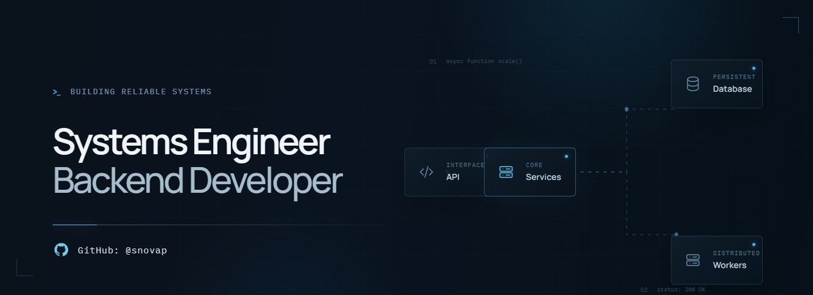

 <!-- Profile Banner -->

  

<h1 align="center">Hi, I'm Sergio Nova 👋</h1>

  

  

---

## <picture></picture> About me
I'm a Systems Engineering student at the **National University of Colombia**, focused on backend development and software engineering.

I enjoy designing and building software solutions, understanding how systems work behind the scenes, and applying engineering principles to create maintainable, reliable, and scalable applications.

- 🎓 **Background:** Systems Engineering at the National University of Colombia.
- 💻 **Focus:** Backend development, APIs, databases, and software architecture.
- ☕ **Current learning path:** Java, Spring Boot, and modern backend engineering practices.
- 🏗️ **Engineering mindset:** Clean Code, Clean Architecture, software design, and secure development.
- 🧩 **Interests:** Problem-solving, algorithms, cloud technologies, and distributed systems.
- 📚 **Goal:** Keep learning, build meaningful projects, and grow as a Backend Software Engineer.

---

##  Tech Stack

### Languages

  
  
  
  

### Backend Development

  
  
  
  

### Databases

  
  
  

### Cloud, Tools & Workflow

  
  
  
  
   
  
  
  
  

---

##  GitHub Analytics

  
  

  

  Note: Language statistics reflect code in public repositories and do not necessarily represent proficiency.

---

## 🐍 Contributions

  <picture>
    <source media="(prefers-color-scheme: dark)" srcset="https://raw.githubusercontent.com/snovap/snovap/output/github-contribution-grid-snake-dark.svg">
    <source media="(prefers-color-scheme: light)" srcset="https://raw.githubusercontent.com/snovap/snovap/output/github-contribution-grid-snake.svg">
    
  </picture>

